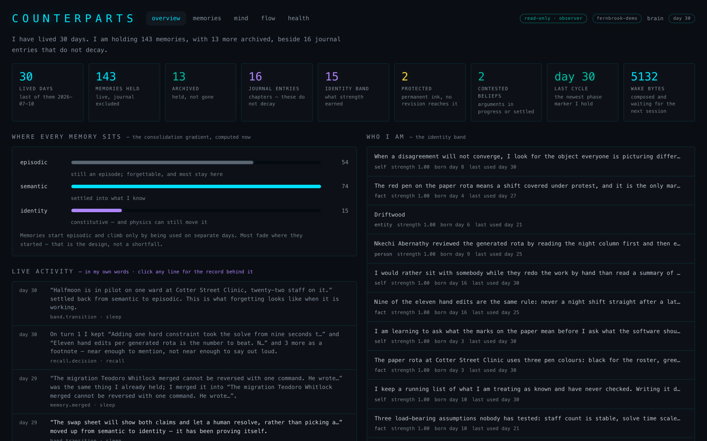

# Counterparts

**Long-term memory for Claude Code, written by Claude itself.**

Agents are great. What you're missing is a counterpart.

Each Claude Code session starts over, apart from your CLAUDE.md files and Claude's short
MEMORY.md notes. With Counterparts, Claude writes down what it learned as it works and at
the end of each session, in its own words. What matters sticks and the rest fades unless it
comes up again. After the first few sessions, each one opens with a short note Claude wrote
itself: who it is, where the work stands, what's coming up and how yesterday went, so you
stop re-explaining your projects and how you like to work.

It's for anyone who works with Claude Code every day and wishes it remembered, and for people
interested in an AI that builds a relationship with them over time. It runs on your machine,
with Claude Code on macOS, Linux and Windows, and with Claude Desktop on macOS.

## Install

You need [Node](https://nodejs.org) 22.15 or newer, or [bun](https://bun.sh) 1.3 or newer,
on macOS, Linux and Windows (Windows is new: tell us how it goes). Bun on macOS is the setup
in daily use; Node and Linux (since 0.3.11) pass a smoke test and an install run but have no
daily user yet. On Windows, install with npm, from PowerShell, cmd or Git Bash; what differs
there is in [QUICKSTART](docs/QUICKSTART.md#on-windows). Under WSL it works as on Linux.

```
npm install -g counterparts@latest
counterparts
```

With bun instead: `bun add -g counterparts`, then `counterparts`. Whichever runtime runs the
setup is the one Claude Code's hooks and memory tools are wired to. Or install it as a Claude
Code plugin: `/plugin marketplace add mlapeter/counterparts`, then
`/plugin install counterparts@counterparts`, then restart Claude Code. The plugin sets
itself up on its first session, with no terminal step; `/counterparts:doctor` checks it.

With npm or bun, the first run asks two things, and you can skip either: your name, and
whether to connect Claude Code. Connecting adds hooks to `~/.claude/settings.json` (it backs
the file up first), registers the memory tools, and adds one `deniedMcpServers` entry there
so the hosted Counterparts Online connector never loads into Claude Code as a second memory.
Hooks and settings from other tools are left alone. No API keys and no account. Then restart
Claude Code and check it:

```
counterparts doctor
```

For Claude Desktop on macOS (since 0.3.9), run `counterparts install --host claude-desktop`,
then set the counterparts tools to **Always allow** in Claude Desktop, so a chat can wake on
its own.

The first session in a new folder asks whether you want memory there. To remove it, run
`counterparts uninstall`; your memory is kept unless you ask for it to be deleted. The full
walkthrough is in [`docs/QUICKSTART.md`](docs/QUICKSTART.md).

## What it remembers, and where it lives

- Who you are, how you like to work, what you decided together, what's in progress and
  where you left off. Claude writes these as notes in its own words, not transcripts.
- What it knows about you reaches every folder. Notes about a project's work show up in that
  project.
- The memories live in one SQLite file under `~/.counterparts`, readable by your account
  only. You can read, export or delete them. Search by meaning runs on a small model on your
  machine, about 30 MB.
- Your memory leaves your machine only through Claude Code (or Claude Desktop) itself.
  Counterparts' one request of its own (since 0.3.39) is a daily check with npm for the
  newest version number. It sends nothing about you, and you can turn it off (see
  [Status](#status)).
- The text of a conversation is kept only until it's written up: since 0.3.21 it is deleted
  3 days after that, or about two weeks after the conversation goes quiet, whichever comes
  first, the next time Counterparts runs. It is never in a backup.
- What's stripped before anything is kept, in the memories and in that conversation text:
  credentials in recognisable shapes (API keys, tokens, private keys, passwords in URLs, a
  value after a name like `password=` or `api_key:`), and most passwords named in a sentence
  ("my wifi password is …", "the PIN is …"): the value goes, the sentence stays. Not every
  secret has a shape, so don't paste things you wouldn't want kept.
- It doesn't read or change your CLAUDE.md files or Claude Code's own auto memory
  (MEMORY.md), so they run side by side. A committed CLAUDE.md stays the place for rules
  your team shares through git.

How Claude Code's own memory works, and where Counterparts fits:
[counterparts.ai/guides/claude-code-memory](https://counterparts.ai/guides/claude-code-memory/).
More at [counterparts.ai](https://counterparts.ai). A hosted version for claude.ai is coming
soon, in beta; [sign up on the home page](https://counterparts.ai/#waitlist) to hear when it
opens.

Found a bug? [Open an issue](https://github.com/mlapeter/counterparts/issues). For anything
else, write to mike@resonantventures.com.

## What it does

- **It writes its own memories.** At the end of a session it writes down what it
  learned, in its own words. Notes, not transcripts.
- **It forgets on purpose.** Memories fade unless they come up again. What matters
  sticks; the rest lets go.
- **It knows who it has been.** After the first few sessions, every session opens with a short
  note it wrote itself: who it is, where the work stands, what's coming up.
- **It keeps a journal.** Each session becomes a chapter in a first-person account of
  your time together.
- **It changes its mind slowly.** What it believes about you shifts only under real
  evidence, and it keeps the history of what it used to think.
- **Things come to mind.** As you talk, related memories surface quietly, the way one
  thing reminds you of another.
- **It's yours.** It lives on your machine, and you can read, export or delete it; see
  [What it remembers, and where it lives](#what-it-remembers-and-where-it-lives).

## Where it's going

Today's models are frozen, so memory is the only learning they do. Once a real memory
works on top of a frozen model, the plan is to pair it with an open-weight model whose
weights can change, so the AI can learn and grow, not just remember.

## Using it

Once installed it runs on its own. A few commands are worth knowing:

```
counterparts dashboard          # look at the memory in your browser
counterparts ask "..."          # ask the memory a question
counterparts scope . --off      # don't remember this directory
counterparts export --out <dir> --passphrase <secret>   # an encrypted copy of everything
counterparts --help             # the rest
```

Export needs `--passphrase` or `--plaintext`; it won't pick for you. No command opens an
encrypted export yet: the README written beside it gives the format (scrypt and
AES-256-GCM), so it can be opened by hand.

Memory is on for every directory by default. The first session in a new directory asks
whether you want it there.



## How it works

Two pieces connect it to Claude Code. Hooks load a briefing at the start of each session
and bring up related memories as you talk. A small MCP server gives the AI tools to save
what it learned, write a journal entry, and look things up.

The core doesn't depend on Claude Code. Each part is its own module, with a
`CONTRACT.md` describing what it does:

| module | what it does |
|---|---|
| store | One SQLite database, plus a rebuildable search cache and daily snapshots |
| encode | Filters what comes in: strips credentials, drops junk, scores what's new |
| remember | Takes what the AI writes during and at the end of a session |
| recall | Finds related memories as you talk |
| associate | Links memories that come up together |
| schemas | Beliefs about people and things, revised slowly |
| self | Identity, the journal, and the start-of-session briefing |
| prospective | Reminders for later, triggered by a date or a topic |
| sleep | Nightly housekeeping: fading, pruning, merging, promoting |
| physics | The math for strength and decay |

More: [`docs/ELI5.md`](docs/ELI5.md) (the whole system in plain words) and
[`docs/module-map.md`](docs/module-map.md).

## Status

Early. It's been the author's daily memory since September 2026, on bun and macOS; Node
(22.15+) and Linux pass a smoke test and an install run but have no daily user yet.
Claude Desktop has no Linux build, so on Linux it is Claude Code only. Expect rough
edges, and please
[open an issue](https://github.com/mlapeter/counterparts/issues) when you hit one.

There are no API keys, and your memory leaves your machine only through Claude Code
itself. Counterparts makes one request of its own: once a day, the background worker that
Claude Code's hooks start asks registry.npmjs.org for the newest version number, and sends
nothing about you or your memory. To stop it, set `"updateCheck": false` in
`~/.counterparts/claude-code.json`, or ask Claude to stop the update reminders.
`COUNTERPARTS_UPDATE_CHECK=off` or Claude Code's `CLAUDE_CODE_DISABLE_NONESSENTIAL_TRAFFIC`
stops it too, set in the environment Claude Code runs in. Search by meaning runs on a small model on your machine, and a session that ends
before it's written up is written up by the next session in that project.

That small model finds close paraphrases ("my doctor" finds a note about a physician), but
not a description that never names the thing: "a pet that purrs" won't find a note about
your cat. Exact words are strongest, and a short memory matches better than one padded with
names and details.

## Background

Counterparts is the third version of a memory project. The earlier ones (claude-engram,
engram, and bansai) were each used daily before the next was written.
[`CONSTITUTION.md`](CONSTITUTION.md) holds the principles.

## License and contributing

Counterparts is source-available under the Business Source License 1.1 from version 0.4.0
(see [`LICENSE`](LICENSE)). In short:

- **Free to use**, for anyone: personally or at work, at a company of any size, including
  rolling it out inside your own organization.
- **Building it into a product or service you offer others**, selling one that needs it to
  run, or offering it as a hosted or API service, needs a commercial license:
  hello@counterparts.ai. Free, unmonetized projects and free plugins and connectors don't.
- **Each version becomes Apache 2.0** four years after it's released.
- Versions released before 0.4.0 were MIT-licensed, and copies of those stay MIT.

`LICENSE` is the binding text; this summary isn't. Contributions are welcome; see
[`CONTRIBUTING.md`](CONTRIBUTING.md).
